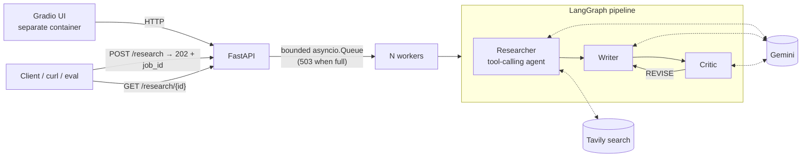

# Multi-Agent Research Assistant

An async research service built on **LangGraph + Gemini + Tavily**. A tool-calling **Researcher** agent decides whether and how often to search the web, a **Writer** drafts a report, and a **Critic** sends it back for revision until it approves or a revision cap is reached.

The project started as a [Colab prototype](prototype/) and was refactored into a FastAPI service with background jobs, retries/backoff, structured logging, an evaluation harness, and a Docker image.

> **Architecture note:** this is a *hybrid* system, not a fully multi-agent one. The Researcher is an autonomous tool-calling agent; the Writer and Critic are single-shot structured LLM calls coordinated by a LangGraph revise loop.

## Architecture



Every outbound call goes through one reliability layer: a shared client-side **rate limiter** (Gemini free-tier quota is per project per model, shared across keys), a **per-attempt timeout**, and **exponential backoff with full jitter** that honors the server's `retryDelay`. Each job also has an overall **deadline**.

## Quick start

### Docker (recommended)

```bash
cp .env.example .env        # add your Gemini and Tavily keys
docker compose up -d --build
open http://localhost:7860          # web UI
open http://localhost:8000/docs     # API docs (Swagger)
```
The web UI is a separate container and a plain client of the HTTP API (submit → 202 → poll); it holds no API keys.

Keys are injected at runtime through environment variables and are never baked into the image. The image runs as a non-root user, and the unit tests run during `docker build --target test`.

### Local

```bash
python -m venv .venv && source .venv/bin/activate
pip install -r requirements-dev.txt
cp .env.example .env        # add your keys
uvicorn app.main:app
```

## API

Interactive docs (Swagger UI) are served at `/docs`.

| Method | Path | Response |
|---|---|---|
| `POST` | `/research` | `202 Accepted` with `{"job_id", "status"}` and a `Location` header. `503` + `Retry-After` when the job queue is full. `422` if `topic` is not 3–300 characters. |
| `GET` | `/research/{job_id}` | Job status (`queued` → `running` → `succeeded` / `failed`), timestamps, and the result once finished. `404` if unknown. |
| `GET` | `/health` | `{"status": "ok", "workers": N, "queue_depth": M}` |

```bash
JOB=$(curl -s -X POST localhost:8000/research \
  -H "Content-Type: application/json" \
  -d '{"topic": "Kafka vs RabbitMQ for event-driven microservices"}' | jq -r .job_id)

curl -s localhost:8000/research/$JOB | jq
```

```json
{
  "job_id": "087aa06c44184a3c9831686cfd2a50c0",
  "status": "succeeded",
  "topic": "Kafka vs RabbitMQ for event-driven microservices",
  "created_at": "2026-11-01T14:55:51.102Z",
  "started_at": "2026-11-01T14:55:51.103Z",
  "finished_at": "2026-11-01T14:56:13.896Z",
  "result": {
    "draft": "# Kafka vs RabbitMQ ...",
    "approved": true,
    "revision_count": 1,
    "research_rounds": 0,
    "critique": "..."
  },
  "error": null
}
```

## Configuration

All settings are read from environment variables (or `.env`) and validated at startup.

| Variable | Default | Purpose |
|---|---|---|
| `RESEARCHER_API_KEY`, `WRITER_API_KEY`, `CRITIC_API_KEY` | — (required) | Gemini keys per role |
| `TAVILY_API_KEY` | — (required) | Web search |
| `MODEL_NAME` | `gemini-3.5-flash-lite` | Model for all roles |
| `WORKERS` | `2` | Concurrent jobs (= concurrent LLM pressure) |
| `MAX_QUEUE` | `20` | Pending jobs before `POST` returns `503` |
| `GEMINI_RPM` | `14` | Client-side rate limit shared by all roles |
| `RETRY_MAX_ATTEMPTS` | `4` | Attempts per LLM/search call, including the first |
| `LLM_TIMEOUT_S` | `30` | Per-request timeout |
| `JOB_TIMEOUT_S` | `300` | Deadline for a whole job |
| `MAX_ITERATIONS` / `MAX_REVISIONS` | `3` / `3` | Researcher search rounds / Writer–Critic loop cap |
| `LOG_LEVEL` | `INFO` | |

## Testing and evaluation

**Unit and component tests** use scripted fake LLMs, so they are deterministic and need no API keys:

```bash
pytest -q                     # 48 tests, < 1s
```

**Evaluation harness** (`evals/`) runs a golden dataset of 18 cases through the real pipeline. Cases are grouped by behavior (current events that require search, evergreen explanations, comparisons, edge inputs, prompt injection). Checks are deterministic rules (required/forbidden terms, length, number of searches), so every failure has an explainable reason.

```bash
python -m evals.runner --smoke              # 5 cases, ~35 Gemini calls
python -m evals.runner --concurrency 2      # all 18 cases
pytest -m eval -s                           # smoke run + regression gate vs evals/baseline.json
```

The regression gate is sized to the noise of a small, non-deterministic eval: any errored case fails; pass rate may drop by at most one case; average LLM calls may grow at most 30%; p95 latency only warns.

Smoke baseline (5 cases, 2026-10-30):

| Pass rate | Critic approval | Avg revisions | Avg LLM calls | Latency p50 / p95 |
|---|---|---|---|---|
| 1.0 | 0.6 | 1.6 | 7.0 | 27.2 s / 51.6 s |

What the eval surfaced so far:
- The same input can take 1 or 3 revision rounds, so cost can nearly double; the Critic's judgment is non-deterministic. This was confirmed by logging the Critic's raw verdict, not assumed.
- The Critic approved a vague report that named no companies on a current-events topic.
- A real bug: a 429 asking to wait ~40 s was given up immediately. Retries now honor server delays up to 60 s.

## Observability

Logs are structured JSON on stdout. A `job_id` is attached to every line through `contextvars`, so pipeline code never passes it around.

| Event | Key fields |
|---|---|
| `job_queued` / `job_started` / `job_finished` | `status`, `duration_ms`, `approved`, `revision_count` |
| `node_finished` | `node`, `revision`, `duration_ms` |
| `call_finished` / `call_retry` / `call_failed` | `target`, `attempts`, `error`, `server_delay_s`, `sleep_s` |
| `rate_limit_wait` | `target`, `waited_s` |
| `research_done` | `research_rounds`, `notes_chars`, `notes_source` |
| `critic_verdict` | `approved`, `verdict_line` |

```bash
docker compose logs --no-log-prefix api \
  | jq -rR 'fromjson? | select(.job_id != null) | [.ts[11:19], .event, (.node // .target // ""), .duration_ms] | @tsv'
```

The eval harness counts API calls from these same events, so evaluation and monitoring share one source of truth.

## Design decisions

- **Background jobs:** in-process `asyncio.Queue` with a fixed worker pool instead of `BackgroundTasks`, so concurrency is bounded (the real bottleneck is the LLM quota) and a full queue gives backpressure. → [ADR 0001](docs/adr/0001-background-jobs.md)
- **Reliability:** retries live in exactly one layer to avoid retry amplification (SDK retries off). A `TavilyAdapter` normalizes the search tool's failure modes: it *returns* `{"error": ...}` on HTTP errors instead of raising. → [ADR 0002](docs/adr/0002-reliability.md)
- **Observability:** structured events with `contextvars`, reused by the eval harness. → [ADR 0003](docs/adr/0003-observability.md)
- **Evaluation:** deterministic checks over LLM-as-judge for cost, stability, and explainability; regression thresholds sized to noise. → [ADR 0004](docs/adr/0004-evaluation.md)

## Known limitations

- **Single process.** Jobs and the queue live in memory: a restart loses jobs, and multiple instances would not share state. The path to scale is Redis/SQS for the queue, Redis/Postgres for job state, and stateless API instances. `JobManager` exposes only `submit` and `get` so it can be swapped.
- **Rate limiter is per process** and allows short bursts within its 60 s window.
- **The Critic cannot verify facts** (it has no tools), which is why it can approve vague or unsupported reports.
- **The eval set is small** (18 cases; smoke = 5). It is good for catching regressions, not for fine-grained comparisons. Rule-based checks catch clear failures, not subtle quality differences.

## Project structure

```
app/          FastAPI service, LangGraph pipeline, reliability, logging
tests/        unit and component tests (fake LLMs, no keys)
evals/        golden dataset, grader, runner, baseline
prototype/    original Colab notebook (history only)
Dockerfile, docker-compose.yml, requirements.lock
ui/           Gradio front end (separate container, API client only)
```